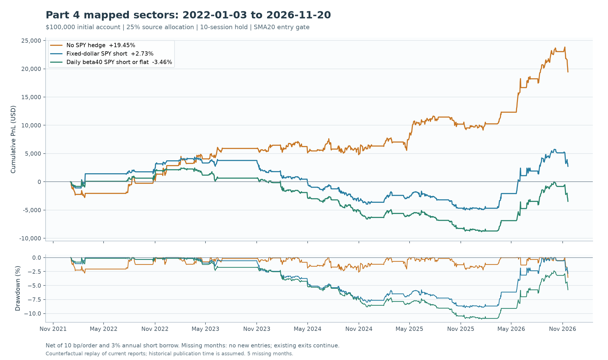

# mapp_strategy — completed extended-history simulation

Period: **3 January 2022–20 November 2026**. Each account starts with **$100,000**, flat, and allocates up to 25% of opening NAV to the source theme. Results are net of 10 bp per net physical order and 3% annual ACT365 short borrow; cash earns 0%.

| Variant | Total return | Ending account | Max drawdown | Realized SPY beta |
|---|---:|---:|---:|---:|
| No SPY hedge | +19.45% | $119,453.44 | −3.55% | 0.063 |
| Fixed-dollar SPY short | +2.73% | $102,734.19 | −8.97% | -0.006 |
| Daily beta SPY short/flat | −3.46% | $96,539.01 | −11.01% | -0.005 |

Each policy used the same **54 completed theme trades** (55 source legs). The source calendar had 86 reserved opportunities; a rejected SMA20 entry still consumed its reserved window. Market-neutral hedge variants reduced realized SPY beta but produced weaker net returns and deeper drawdowns in this replay.

## Archive gaps

Validated **1,171** dated reports. No new entries were allowed in **July–October 2023** or **May 2024**. Existing positions and hedge management continued to their scheduled exits. The two carryovers were SPY, 16 June–3 July 2023, and XLE, 30 April–14 May 2024. The account clock was continuous across gaps.

## Costs and exposure

| Variant | Transaction costs | Short borrow | Peak sampled gross exposure |
|---|---:|---:|---:|
| No SPY hedge | $2,904.26 | $0.00 | 28.78% |
| Fixed-dollar SPY short | $5,211.40 | $1,544.28 | 53.64% |
| Daily beta SPY short/flat | $5,476.93 | $1,568.86 | 107.58% |

Gross exposure is sampled after opening orders and at daily closes. The beta hedge is uncapped; the 25% source budget does not cap total gross exposure once SPY is added.

## Calendar returns

| Year | No hedge | Fixed SPY short | Daily beta hedge |
|---|---:|---:|---:|
| 2022 | +2.86% | +3.71% | +2.13% |
| 2023 | +3.51% | −1.84% | −2.24% |
| 2024 | −0.13% | −5.33% | −6.17% |
| 2025 | +3.01% | −1.20% | −2.38% |
| 2026 through 20 Nov | +9.07% | +7.89% | +5.55% |

## Rules and validation

Only the fourth positional topic of What Retail Is Playing supplies the theme. The frozen 153-stock crosswalk and 17-ETF universe are unchanged. Eligibility and lagged 20-session median dollar volume are checked before reservation; directional SMA20 uses completed prior closes. Source units are fixed for ten subsequent US sessions, subject to the 21-calendar-day cap, followed by the complete flat-session wait. Rejected leg weights remain cash. Hedges are SPY short or flat. No RSI, weekly filter, new stop or parameter optimization was added.

A pre-outcome parsing fix maps the complete gold-futures identifier GC=F to GLD and rejects unsupported complete futures identifiers so the suffix F cannot become Ford. This affected 3 gold report headings and excluded 13 unsupported futures headings in Part 4.

Independent raw-price/source/mapping/clock, cash/NAV, order fees, borrow and beta audits passed. The existing economic simulator is unchanged. Reports were reconstructed retrospectively; availability at printed-date 23:59:59 New York is assumed. These results do not establish contemporaneous publication or live trading performance.

## Files

- [All trades: dates, ETF mappings and net results](all_trades.csv)
- [All physical simulated orders](all_orders.csv)
- [Coverage and missing-month record](coverage.json)
- [Annual returns](diagnosis/calendar_year_returns.csv)
- [Independent financial audit](diagnosis/independent_results.json)
- [Complete result ZIP](mapp_strategy_extended_simulated_results.zip)
- [Vector PnL chart](figures/mapp_strategy_extended_pnl.svg)

Execution: [GitHub Actions run 44830228394](https://github.com/marcinzieba4-bot/DailyDigest_Markets/actions/runs/44830228394), code 5f28d29e918eaf28ecf251ceb92609bc8b1fc285. The ZIP SHA256 is `fb38b0cc881183a9e6cba642b31beac6b640aac0f937aa90ae9235fc758a5d59`. Source/price raw files remain outside the public results package.

## Trade mapping and results

All PnL columns below are net dollars in separate initially $100,000 accounts. Full quantity, cost and borrow fields are in the CSV/ZIP.

| Report | Entry | Exit | Source position | No hedge | Fixed SPY | Beta SPY |
|---|---|---|---|---:|---:|---:|
| 2022-01-04 | 2022-01-05 | 2022-01-20 | Long XLY | −$2,233.60 | −$1,087.04 | −$816.51 |
| 2022-02-08 | 2022-02-09 | 2022-02-24 | Long XLE | +$179.26 | +$2,503.57 | +$899.45 |
| 2022-07-20 | 2022-07-21 | 2022-08-04 | Long XLI | +$1,531.64 | +$205.46 | +$358.07 |
| 2022-08-08 | 2022-08-09 | 2022-08-23 | Long XLF | +$259.35 | +$142.30 | +$199.28 |
| 2022-10-24 | 2022-10-25 | 2022-11-08 | Long XLE | +$1,612.00 | +$1,408.67 | +$1,330.94 |
| 2022-11-28 | 2022-11-29 | 2022-12-13 | Long XLK | +$1,512.23 | +$535.18 | +$159.94 |
| 2023-01-23 | 2023-01-24 | 2023-02-07 | Long QQQ + Long SPY | +$991.29 | +$335.55 | +$245.46 |
| 2023-02-10 | 2023-02-13 | 2023-02-28 | Long XLF | −$598.94 | +$47.53 | −$112.35 |
| 2023-03-17 | 2023-03-20 | 2023-04-03 | Long XLK | +$1,246.51 | −$27.85 | −$322.08 |
| 2023-04-04 | 2023-04-05 | 2023-04-20 | Long XLC | −$444.94 | −$737.81 | −$766.58 |
| 2023-05-11 | 2023-05-12 | 2023-05-26 | Long XLC | +$490.98 | +$286.79 | +$219.53 |
| 2023-05-30 | 2023-05-31 | 2023-06-14 | Long SOXX | +$1,415.58 | +$160.82 | −$750.70 |
| 2023-06-15 | 2023-06-16 | 2023-07-03 | Long SPY | −$58.89 | −$0.00 | −$0.00 |
| 2023-11-01 | 2023-11-02 | 2023-11-16 | Long GLD | −$236.58 | −$1,691.19 | −$224.83 |
| 2023-11-21 | 2023-11-22 | 2023-12-07 | Long XLK | −$249.32 | −$431.62 | −$442.13 |
| 2023-12-12 | 2023-12-13 | 2023-12-28 | Long XLY | +$1,052.08 | +$148.14 | −$130.57 |
| 2024-01-23 | 2024-01-24 | 2024-02-07 | Long SOXX | −$589.91 | −$1,086.67 | −$1,490.63 |
| 2024-02-12 | 2024-02-13 | 2024-02-28 | Long XLI | +$854.90 | +$181.53 | +$191.78 |
| 2024-03-01 | 2024-03-04 | 2024-03-18 | Long XLC | +$259.55 | −$9.78 | −$73.53 |
| 2024-03-25 | 2024-03-26 | 2024-04-10 | Long XLY | −$759.81 | −$422.81 | −$376.72 |
| 2024-04-29 | 2024-04-30 | 2024-05-14 | Long XLE | −$770.91 | −$1,428.16 | −$1,098.23 |
| 2024-06-03 | 2024-06-04 | 2024-06-18 | Long XLC | +$121.86 | −$411.57 | −$445.96 |
| 2024-06-24 | 2024-06-25 | 2024-07-10 | Long XLY | +$1,225.05 | +$471.51 | +$459.55 |
| 2024-07-11 | 2024-07-12 | 2024-07-26 | Long XLY | −$1,020.38 | −$342.51 | −$217.09 |
| 2024-08-16 | 2024-08-19 | 2024-09-03 | Long SOXX | −$457.36 | −$762.46 | −$1,255.82 |
| 2024-09-04 | 2024-09-05 | 2024-09-19 | Long GLD | +$570.74 | −$440.99 | +$140.76 |
| 2024-09-20 | 2024-09-23 | 2024-10-07 | Long XLY | −$106.52 | −$258.91 | −$312.06 |
| 2024-10-09 | 2024-10-10 | 2024-10-24 | Long XLY | −$18.19 | −$271.40 | −$351.42 |
| 2024-10-28 | 2024-10-29 | 2024-11-12 | Long XLK | +$522.69 | −$384.75 | −$954.44 |
| 2024-11-13 | 2024-11-14 | 2024-11-29 | Long XLK | −$457.05 | −$587.91 | −$648.75 |
| 2024-12-02 | 2024-12-03 | 2024-12-17 | Long XLK | +$484.40 | +$332.03 | +$272.88 |
| 2025-01-28 | 2025-01-29 | 2025-02-12 | Long GLD | +$1,260.04 | +$1,246.71 | +$1,146.71 |
| 2025-02-13 | 2025-02-14 | 2025-03-03 | Long GLD | −$550.71 | −$31.50 | −$435.79 |
| 2025-04-09 | 2025-04-10 | 2025-04-25 | Long XLY | +$404.16 | −$374.06 | −$398.27 |
| 2025-04-28 | 2025-04-29 | 2025-05-13 | Long XLK | +$2,714.61 | +$851.48 | +$397.93 |
| 2025-05-14 | 2025-05-15 | 2025-05-30 | Long XLI | +$254.90 | +$6.57 | +$25.12 |
| 2025-06-02 | 2025-06-03 | 2025-06-17 | Long GLD | +$220.72 | −$207.19 | +$188.76 |
| 2025-06-24 | 2025-06-25 | 2025-07-10 | Long XLY | +$346.77 | −$428.43 | −$694.43 |
| 2025-07-11 | 2025-07-14 | 2025-07-28 | Long XLF | +$597.64 | −$112.03 | −$192.29 |
| 2025-07-29 | 2025-07-30 | 2025-08-13 | Long XLF | −$119.03 | −$524.22 | −$556.29 |
| 2025-09-18 | 2025-09-19 | 2025-10-03 | Long XLC | −$569.66 | −$850.87 | −$779.79 |
| 2025-10-06 | 2025-10-07 | 2025-10-21 | Long XLF | −$681.84 | −$625.91 | −$650.24 |
| 2025-11-07 | 2025-11-10 | 2025-11-24 | Long XLF | −$673.23 | −$144.99 | −$327.07 |
| 2025-12-01 | 2025-12-02 | 2025-12-16 | Long XLC | +$165.72 | +$162.89 | +$146.34 |
| 2025-12-22 | 2025-12-23 | 2026-01-08 | Long XLK | +$170.22 | −$101.92 | −$244.52 |
| 2026-01-13 | 2026-01-14 | 2026-01-29 | Long XLK | +$385.98 | +$72.00 | −$24.72 |
| 2026-03-12 | 2026-03-13 | 2026-03-27 | Long XLE | +$2,065.24 | +$2,601.46 | +$1,833.11 |
| 2026-05-19 | 2026-05-20 | 2026-06-04 | Long SOXX | +$4,354.46 | +$3,171.05 | +$2,141.96 |
| 2026-06-24 | 2026-06-25 | 2026-07-10 | Long XLV | +$1,554.65 | +$815.81 | +$1,268.43 |
| 2026-08-04 | 2026-08-05 | 2026-08-19 | Long XLE | +$2,490.71 | +$2,246.96 | +$2,033.64 |
| 2026-08-21 | 2026-08-24 | 2026-09-08 | Long XLE | +$696.97 | +$371.02 | +$569.07 |
| 2026-09-09 | 2026-09-10 | 2026-09-24 | Long XLK | +$1,245.22 | +$715.85 | +$395.38 |
| 2026-09-25 | 2026-09-28 | 2026-10-12 | Long XLK | +$382.34 | −$112.06 | −$355.55 |
| 2026-11-05 | 2026-11-06 | 2026-11-20 | Long GLD | −$3,590.18 | −$2,390.05 | −$2,635.71 |
