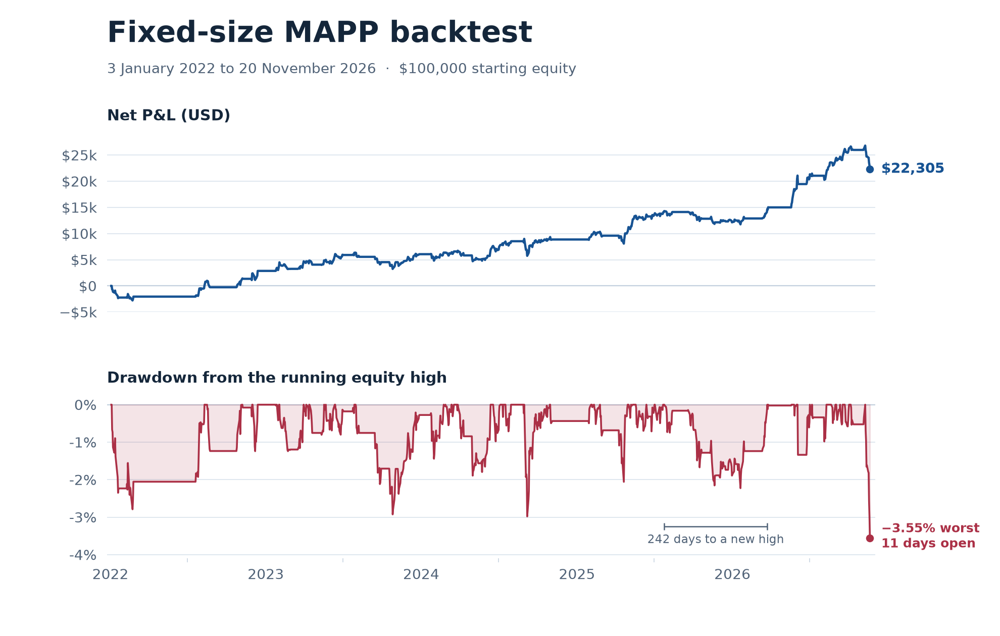

# mapp_strategy fixed 25% backtest with full archive coverage

**[Download the 6-page PDF strategy report](mapp_strategy_report.pdf)**: strategy logic, risk statistics, comparison with SPY, monthly returns and trade charts. It is built from this folder's ledgers by [`ci/strategy_report_pdf.py`](../../ci/strategy_report_pdf.py).

The unhedged, fixed-size strategy grew **$100,000 to $122,305.16** from **January 3, 2022 through November 20, 2026**. It returned **22.31% net** with a **3.55% maximum closing drawdown**. The median completed recovery to a new equity high was **13.5 calendar days**. Three completed recoveries took more than 200 days.

This is the `absolute_reserved` schedule and `unhedged25` policy from the earlier comparison. The basket budget stays at 25% of opening equity after every win or loss. The continuous replay covers **1,227 U.S. market sessions** and **1,281 validated reports**, including 1,275 weekday reports and six weekend reports. The new archive adds 89 reports since the prior comparison. August, September, and October 2023 contribute 23, 21, and 22 reports, respectively, and May 2024 contributes 23. All report months and weekdays in the study are represented. [Previous comparison](../2022_2026_relative_clock/README.md) · [Report archive](https://d7g7nkeytae81.cloudfront.net/reports/index.html)

## P&L and drawdown

The chart marks open ETF positions at each daily close and includes accrued trading costs. Gross trade P&L of **$25,325.68** less **$3,020.52** in order fees gives net P&L of **$22,305.16**. All 55 baskets completed their normal timed exits. [Daily portfolio ledger](daily_nav.csv)

## Full-window risk and return

| Metric | Result |
|---|---:|
| Net return / compound annual growth rate | +22.31% / +4.21% |
| Annualized daily volatility / downside deviation | 3.58% / 2.35% |
| Sharpe / Sortino / Calmar | 1.17 / 1.79 / 1.19 |
| Maximum closing drawdown | −3.55% |
| Worst / best daily return | −1.93% on Sep 3, 2024 / +1.59% on May 26, 2026 |
| Daily historical 95% VaR / expected shortfall | 0.35% / 0.53% |
| Daily historical 99% VaR / expected shortfall | 0.64% / 0.85% |
| Realized SPY beta, all / active sessions | 0.067 / 0.204 |
| Average gross exposure at daily close | 11.25% |
| Highest sampled gross exposure, open or close | 28.78% |
| Lowest closing cash share | 71.24% |
| Sessions with a position or basket execution | 605 of 1,227 (49.3%) |
| Net winners / losers | 38 / 17 (69.1% win rate) |
| Profit factor after costs | 2.60 |
| Average net winner / loser | +$954.19 / −$820.82 |
| Best / worst closed basket by dollars | SOXX +$4,458.40 / GLD −$3,675.45 |
| Longest losing streak | 4 baskets, −$1,432.74 net |

Daily returns use previous closing equity, with the initial $100,000 as the base for the first session. Volatility is sample daily standard deviation scaled by √252. Sharpe uses a zero risk-free rate. Sortino uses a zero target and the root mean square of negative daily returns, with other returns contributing zero. Calmar divides calendar-time CAGR by the magnitude of maximum drawdown. Historical VaR reports the empirical loss quantile, and expected shortfall averages losses at or beyond it. The 95% and 99% shortfall estimates use 62 and 13 observations, respectively. The highest exposure can exceed the entry budget as held positions appreciate. [Exact metrics and input fingerprints](risk_metrics.json)

### Calendar-year windows

Returns use prior year-end equity as the base, and within-year drawdowns start from the same anchor. The full-period recovery calculation carries the running peak across year boundaries. Trade counts are grouped by entry date.

| Window | Reports | Market sessions | Baskets | Net P&L | Net return | Annualized volatility | Within-year max drawdown |
|---|---:|---:|---:|---:|---:|---:|---:|
| 2022 | 260 | 251 | 6 | +$2,860.89 | +2.86% | 3.11% | −2.79% |
| 2023 | 260 | 250 | 13 | +$3,194.81 | +3.11% | 3.05% | −2.93% |
| 2024 | 262 | 252 | 13 | +$2,810.02 | +2.65% | 3.86% | −2.98% |
| 2025 | 261 | 250 | 14 | +$3,273.26 | +3.01% | 3.19% | −2.15% |
| 2026 through Nov 20 | 238 | 224 | 9 | +$10,166.18 | +9.07% | 4.58% | −3.55% |

## Recovery to a new equity high

Recovery begins at the last close at the running high before equity falls below it and ends at the first close strictly above that high. An exact tie after a decline leaves the episode open. Of 47 episodes, **46 completed**. Their median was **13.5 calendar days (9 sessions)**, their 90th percentile was **80 calendar days (55.5 sessions)**, and the longest lasted **242 calendar days (166 sessions)**. Closing equity was below its running high in **1,075 sessions (87.6%)**.

| Prior peak | Trough | First higher close | Peak to recovery | Max drawdown |
|---|---|---|---:|---:|
| 2025-07-25 | 2026-01-20 | 2026-03-24 | 242 days | −2.23% |
| 2022-01-04 | 2022-02-22 | 2022-08-10 | 218 days | −2.79% |
| 2023-07-31 | 2023-10-26 | 2024-02-23 | 207 days | −2.93% |
| 2026-11-09 | 2026-11-20 | Open at cutoff | 11 days elapsed | −3.55% |

The final GLD basket closed on November 20. The account finished **$4,503.31 below** its November 9 high of **$126,808.47**, so that equity episode remains open and is excluded from completed-recovery statistics. [All drawdown episodes](drawdown_episodes.csv)

## Trading rules

1. **Select the theme.** Take only the fourth topic in *What Retail Is Playing*. Map the heading into the frozen 17-ETF universe. Treat reports as available at 23:59:59 New York time on their printed date. At an eligible opening, use the latest ready report, at most four calendar days old. Each report can reserve at most one window. [Frozen mapping](../../source_tools/frozen_mapping/map_retail_etf.py)
2. **Check eligibility and reserve.** Require an eligible USD instrument on a U.S. session with an opening price and median raw daily dollar volume of at least $10 million over the preceding 20 sessions. Once a report has a basic-eligible target, reserve its window before trend qualification. The clock stays reserved even if every target fails that gate. There were 93 reserved opportunities and 55 funded baskets. [Reservation clock](../../ci/run_extended_history.py)
3. **Apply the absolute SMA20 gate.** Compare the last completed adjusted close with the average of the last 20 completed adjusted closes, including that last close. A long requires that close to be strictly above the average and a short requires it to be strictly below. Split the budget equally across the original mapped legs before qualification. Rejected legs leave their allocation in cash. The funded sample contained 56 long legs across 55 baskets. [Eligibility and trend logic](../../engine/data.py)
4. **Size the basket and hold.** Budget at most 25% of opening portfolio equity, including entry fees, and hold share counts fixed. Each order incurs 10 basis points on its notional. Net shorts would cost 3% annual ACT/365 borrow, and cash earns zero interest. The account runs without a separate hedge and incurred zero borrow. [Accounting engine](../../engine/run_nohedge.py)
5. **Exit and wait.** Release the basket at the opening of the tenth subsequent U.S. trading session, subject to a 21-calendar-day cap. A new reservation can begin after the release session and the following session. This run held each funded basket for exactly ten subsequent sessions. The final basket exited on the last session’s open.

## Complete trade history

All entries and exits below use the New York market open. Net account return divides the basket’s net P&L by equity at entry. The CSV also contains adjusted execution prices, funded notional, gross P&L, fees, basket returns, and cumulative account returns. [Full trade ledger](trades.csv)

| # | Report date | Entry date | Exit date | Funded ETF positions | Net P&L | Net account return | Equity after exit |
|---:|---|---|---|---|---:|---:|---:|
| 1 | 2022-01-04 | 2022-01-05 | 2022-01-20 | Long XLY | −$2,233.60 | −2.23% | $97,766.40 |
| 2 | 2022-02-08 | 2022-02-09 | 2022-02-24 | Long XLE | +$179.27 | +0.18% | $97,945.67 |
| 3 | 2022-07-20 | 2022-07-21 | 2022-08-04 | Long XLI | +$1,531.64 | +1.56% | $99,477.31 |
| 4 | 2022-08-08 | 2022-08-09 | 2022-08-23 | Long XLF | +$259.36 | +0.26% | $99,736.67 |
| 5 | 2022-10-24 | 2022-10-25 | 2022-11-08 | Long XLE | +$1,611.99 | +1.62% | $101,348.66 |
| 6 | 2022-11-28 | 2022-11-29 | 2022-12-13 | Long XLK | +$1,512.23 | +1.49% | $102,860.89 |
| 7 | 2023-01-23 | 2023-01-24 | 2023-02-07 | Long QQQ, Long SPY | +$991.29 | +0.96% | $103,852.18 |
| 8 | 2023-02-10 | 2023-02-13 | 2023-02-28 | Long XLF | −$598.94 | −0.58% | $103,253.24 |
| 9 | 2023-03-17 | 2023-03-20 | 2023-04-03 | Long XLK | +$1,246.51 | +1.21% | $104,499.75 |
| 10 | 2023-04-04 | 2023-04-05 | 2023-04-20 | Long XLC | −$444.94 | −0.43% | $104,054.81 |
| 11 | 2023-05-11 | 2023-05-12 | 2023-05-26 | Long XLC | +$490.98 | +0.47% | $104,545.78 |
| 12 | 2023-05-30 | 2023-05-31 | 2023-06-14 | Long SOXX | +$1,415.58 | +1.35% | $105,961.37 |
| 13 | 2023-06-15 | 2023-06-16 | 2023-07-03 | Long SPY | −$58.90 | −0.06% | $105,902.47 |
| 14 | 2023-07-24 | 2023-07-25 | 2023-08-08 | Long QQQ | −$355.02 | −0.34% | $105,547.45 |
| 15 | 2023-09-14 | 2023-09-15 | 2023-09-29 | Long XLK | −$1,013.08 | −0.96% | $104,534.37 |
| 16 | 2023-10-18 | 2023-10-19 | 2023-11-02 | Long XLK | −$5.75 | −0.01% | $104,528.62 |
| 17 | 2023-11-07 | 2023-11-08 | 2023-11-22 | Long XLV | +$220.95 | +0.21% | $104,749.58 |
| 18 | 2023-11-24 | 2023-11-27 | 2023-12-11 | Long XLB | +$258.12 | +0.25% | $105,007.70 |
| 19 | 2023-12-12 | 2023-12-13 | 2023-12-28 | Long XLY | +$1,048.00 | +1.00% | $106,055.70 |
| 20 | 2024-01-23 | 2024-01-24 | 2024-02-07 | Long SOXX | −$587.62 | −0.55% | $105,468.08 |
| 21 | 2024-02-12 | 2024-02-13 | 2024-02-28 | Long XLI | +$851.58 | +0.81% | $106,319.66 |
| 22 | 2024-03-01 | 2024-03-04 | 2024-03-18 | Long XLC | +$258.56 | +0.24% | $106,578.22 |
| 23 | 2024-03-25 | 2024-03-26 | 2024-04-10 | Long XLY | −$756.86 | −0.71% | $105,821.36 |
| 24 | 2024-04-29 | 2024-04-30 | 2024-05-14 | Long XLE | −$767.93 | −0.73% | $105,053.43 |
| 25 | 2024-05-21 | 2024-05-22 | 2024-06-06 | Long XLC | +$667.85 | +0.64% | $105,721.28 |
| 26 | 2024-06-10 | 2024-06-11 | 2024-06-26 | Long XLK | +$1,287.69 | +1.22% | $107,008.97 |
| 27 | 2024-06-27 | 2024-06-28 | 2024-07-15 | Long XLY | +$1,260.18 | +1.18% | $108,269.15 |
| 28 | 2024-07-16 | 2024-07-17 | 2024-07-31 | Long XLF | +$263.07 | +0.24% | $108,532.22 |
| 29 | 2024-08-28 | 2024-08-29 | 2024-09-13 | Long SOXX | −$799.45 | −0.74% | $107,732.77 |
| 30 | 2024-09-16 | 2024-09-17 | 2024-10-01 | Long GLD | +$750.04 | +0.70% | $108,482.81 |
| 31 | 2024-10-02 | 2024-10-03 | 2024-10-17 | Long XLY | +$374.96 | +0.35% | $108,857.77 |
| 32 | 2024-10-18 | 2024-10-21 | 2024-11-04 | Long GLD | +$7.95 | +0.01% | $108,865.72 |
| 33 | 2025-01-28 | 2025-01-29 | 2025-02-12 | Long GLD | +$1,290.12 | +1.19% | $110,155.84 |
| 34 | 2025-02-13 | 2025-02-14 | 2025-03-03 | Long GLD | −$563.85 | −0.51% | $109,591.99 |
| 35 | 2025-04-09 | 2025-04-10 | 2025-04-25 | Long XLY | +$413.80 | +0.38% | $110,005.79 |
| 36 | 2025-04-28 | 2025-04-29 | 2025-05-13 | Long XLK | +$2,779.41 | +2.53% | $112,785.20 |
| 37 | 2025-05-14 | 2025-05-15 | 2025-05-30 | Long XLI | +$260.99 | +0.23% | $113,046.19 |
| 38 | 2025-06-02 | 2025-06-03 | 2025-06-17 | Long GLD | +$225.99 | +0.20% | $113,272.18 |
| 39 | 2025-06-24 | 2025-06-25 | 2025-07-10 | Long XLY | +$355.05 | +0.31% | $113,627.23 |
| 40 | 2025-07-11 | 2025-07-14 | 2025-07-28 | Long XLF | +$611.90 | +0.54% | $114,239.13 |
| 41 | 2025-07-29 | 2025-07-30 | 2025-08-13 | Long XLF | −$121.87 | −0.11% | $114,117.26 |
| 42 | 2025-09-18 | 2025-09-19 | 2025-10-03 | Long XLC | −$583.25 | −0.51% | $113,534.01 |
| 43 | 2025-10-06 | 2025-10-07 | 2025-10-21 | Long XLF | −$698.11 | −0.61% | $112,835.89 |
| 44 | 2025-11-07 | 2025-11-10 | 2025-11-24 | Long XLF | −$689.30 | −0.61% | $112,146.59 |
| 45 | 2025-12-01 | 2025-12-02 | 2025-12-16 | Long XLC | +$169.67 | +0.15% | $112,316.26 |
| 46 | 2025-12-22 | 2025-12-23 | 2026-01-08 | Long XLK | +$174.29 | +0.16% | $112,490.55 |
| 47 | 2026-01-13 | 2026-01-14 | 2026-01-29 | Long XLK | +$395.19 | +0.35% | $112,885.74 |
| 48 | 2026-03-12 | 2026-03-13 | 2026-03-27 | Long XLE | +$2,114.54 | +1.87% | $115,000.27 |
| 49 | 2026-05-19 | 2026-05-20 | 2026-06-04 | Long SOXX | +$4,458.40 | +3.88% | $119,458.67 |
| 50 | 2026-06-24 | 2026-06-25 | 2026-07-10 | Long XLV | +$1,591.76 | +1.33% | $121,050.43 |
| 51 | 2026-08-04 | 2026-08-05 | 2026-08-19 | Long XLE | +$2,550.17 | +2.11% | $123,600.60 |
| 52 | 2026-08-21 | 2026-08-24 | 2026-09-08 | Long XLE | +$713.61 | +0.58% | $124,314.20 |
| 53 | 2026-09-09 | 2026-09-10 | 2026-09-24 | Long XLK | +$1,274.94 | +1.03% | $125,589.15 |
| 54 | 2026-09-25 | 2026-09-28 | 2026-10-12 | Long XLK | +$391.46 | +0.31% | $125,980.61 |
| 55 | 2026-11-05 | 2026-11-06 | 2026-11-20 | Long GLD | −$3,675.45 | −2.92% | $122,305.16 |

## Data and verification

The archive audit read the full dated HTML for each report. Thirteen valid reports had fewer than four topics, yielding no Part 4 trade signal. The market audit independently decoded one Yahoo daily price campaign for all 17 ETFs, verified 25,211 price rows with warm-up from December 28, 2020, and checked the entry schedule against the frozen rules. Execution prices use raw opens scaled by the adjusted-close to raw-close ratio. A separate price-and-positions replay reproduced every daily equity mark and all 55 basket P&Ls. [Input audit implementation](../../ci/extended_input_audit.py) · [Machine-readable metrics](risk_metrics.json)

The current reports are retrospective reconstructions. Printed-date availability is a simulation assumption, and the performance estimates apply to that replay. Masking the restored report dates on the same price snapshot reproduced the preceding run’s +19.05% return at display precision. The full-coverage replay changed 12 of the 55 basket windows because new reports can change the subsequent reservation sequence. [Preceding archive coverage](../2022_2026_relative_clock/coverage.json)

The repository’s [extended-history workflow](../../README.md#reproduce-the-extended-study) reads the current archive and Yahoo snapshots. The `unhedged25` ledger from that workflow is the fixed-size policy covered here. The committed daily, trade, and drawdown ledgers preserve this run’s results for analysis independent of later input revisions.
