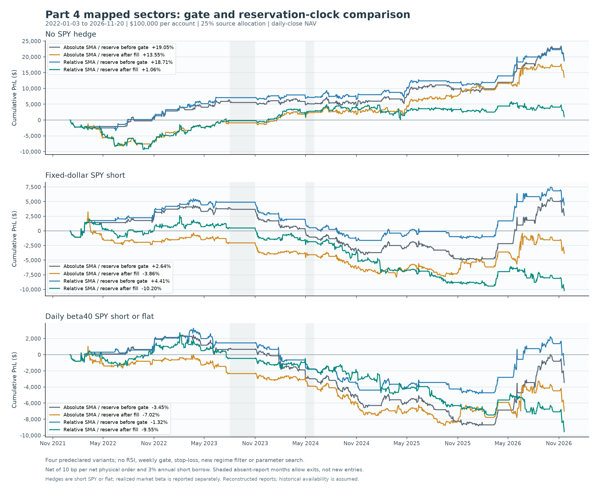

# mapp_strategy: relative-strength gate and fill-only clock

**The combined proposal failed this simulation.** Removing reservations after rejected signals worsened results. Replacing the absolute trend gate with a sector/SPY relative-strength gate while retaining the original reservation produced a modest improvement in the fixed-SPY-short account, with lower exposure and costs. It remains dependent on energy and 2026.

The shared simulation covers **January 3, 2022–November 20, 2026**, using **1,192 validated public reports** and one coherent 17-ETF price campaign. All twelve accounts start at $100,000. This is a retrospective replay, not untouched forward validation.

## Primary comparison: fixed-dollar SPY short

| Rule set | Baskets | Total net return | Maximum drawdown | Average gross exposure |
|---|---:|---:|---:|---:|
| Existing absolute SMA + reserved wait | 55 | +2.64% | -9.05% | 21.70% |
| Clock change only | 71 | -3.86% | -10.78% | 27.19% |
| Relative-strength filter only | 44 | +4.41% | -6.83% | 17.61% |
| Both proposed changes | 71 | -10.20% | -12.48% | 28.56% |

Returns cover the full period and are not annualized. Drawdowns use daily closing NAV. Each source allocation is up to 25% of its own account NAV; rejected target weights remain cash. Average gross exposure includes source and hedge.

## PnL for all twelve accounts



| Rule set | No SPY hedge | Fixed-dollar SPY short | Daily beta40 SPY short/flat |
|---|---:|---:|---:|
| Existing absolute SMA + reserved wait | +19.05% | +2.64% | -3.45% |
| Clock change only | +13.55% | -3.86% | -7.02% |
| Relative-strength filter only | +18.71% | +4.41% | -1.32% |
| Both proposed changes | +1.06% | -10.20% | -9.55% |

Hedges never buy SPY. Realized all-day SPY beta for the four fixed-short accounts is approximately −0.0061, −0.0018, −0.0033 and −0.0026 respectively. Dollar balance and beta neutrality are distinct; full exposure and active-day beta diagnostics are in metrics.csv.

## What the results imply

The combined variant loses **$10,201.12 net** and **$1,403.58 before costs**. Its failure is not explained solely by turnover.

Relative strength alone improves the fixed-short result by **$1,768.29** versus the rerun control. Accounting for the separate compounded ledgers, that difference comprises **$591.89 more gross spread profit** and **$1,176.40 lower modeled fees and borrow**. It trades 44 rather than 55 baskets.

That modest improvement does not establish broad alpha. The relative-only fixed-short account's five XLE baskets contribute **+$5,548.23 net**, while its other baskets contribute **−$1,140.10**. Trades entered before 2026 contribute **−$1,071.99**, and 2026 entries contribute **+$5,480.13**. These are attribution on actual account notionals, not new simulations with a group removed.

The fill-only clock increases exposure and trading. Its changed sequence misses some profitable later opportunities while adding others. The comparison shows the economic outcome of these complete schedules; it does not establish that a particular arbitrary waiting length has universal predictive value.

## Fixed-short calendar returns

| Rule set | 2022 | 2023 | 2024 | 2025 | 2026 through Nov 20 |
|---|---:|---:|---:|---:|---:|
| Existing absolute SMA + reserved wait | +3.71% | -1.93% | -5.33% | -1.20% | +7.89% |
| Clock change only | -1.62% | -2.33% | -3.15% | +1.73% | +1.56% |
| Relative-strength filter only | +4.19% | -1.24% | -4.40% | +0.55% | +5.56% |
| Both proposed changes | +0.53% | -1.95% | -3.95% | -3.79% | -1.43% |

Calendar returns mark positions across year-end. Entry-year attribution in concentration.json uses a different grouping and is labeled explicitly.

## Four fixed rule sets

1. **absolute_reserved:** unchanged control. The previous completed adjusted price must exceed its previous-20-close mean for a long, with the inverse condition for a source short. Reserve the window before qualification, including all-rejected opportunities.
2. **absolute_filled:** same absolute filter. A basic-eligible SMA attempt consumes its report; an all-rejected attempt creates no reservation or cooldown. The next new report can qualify.
3. **relative_reserved:** replace the absolute gate with the adjusted ETF/SPY ratio compared with its preceding 20 completed ratios. Keep the original pre-qualification reservation.
4. **relative_filled:** combine the relative filter and fill-only reservation.

The relative test is strict, so a genuine source SPY target has a constant SPY/SPY ratio and fails it. Rejected weights are not redistributed. Both filters use only completed sessions before entry.

Basic mapping, USD/session and liquidity tests, report availability and four-calendar-day freshness, one active cohort, ten-subsequent-session opening exit, 21-calendar-day cap, release-day exclusion and following-session cooldown after funded trades are unchanged. No RSI, weekly filter, new stop, macro-regime gate or parameter optimization was added. Costs remain 10 bp per net physical order and 3% ACT365 on net shorts, with zero cash yield. No source shorts were funded in this sample.

## Refreshed archive and control

**July 2023 is now present**, adding 21 reports relative to the earlier 1,171-report snapshot. The refreshed control has 55 rather than 54 funded baskets, including a QQQ trade entered July 25, 2023 and exited August 8, 2023. Small market-data vintage changes are also possible. The old saved returns were not substituted for the current control.

The remaining absent months are August–October 2023 and May 2024. They create no new entries; existing positions and hedges continue to normal exits. All four schedules share exactly the same refreshed inputs, so their within-study comparisons are consistent. See baseline_comparison.json and coverage.json.

## Reproduce and inspect

From a fresh checkout without generated variant folders:

```bash
cd strategies/mapp_strategy
python -m pip install -r requirements.txt
python mapp_strategy.py relative-clock --start 2022-01-01 --end 2026-11-20 --workers 12
```

Independent source, price and schedule audits run before portfolio outcomes. The frozen economic engine and mapping are unchanged. Independent financial reconstruction checks all twelve ledgers. A separate JavaScript export audit verified all 99 ZIP members, all 98 manifest entries, 14,724 daily NAV rows, 723 baskets and 60 annual return rows; all 729 source legs were long. Chart endpoints/drawdowns, costs, exposure and realized betas agree.

[Execution run](https://github.com/marcinzieba4-bot/DailyDigest_Markets/actions/runs/44888424156) · [All trades](all_trades.csv) · [Metrics](metrics.csv) · [Calendar returns](calendar_year_returns.csv) · [Rejected and funded attempts](entry_attempts.csv) · [Entry qualification](entry_qualification.csv) · [Concentration](concentration.json) · [Complete simulated ZIP](mapp_strategy_relative_clock_simulated_results.zip)

The ZIP also contains all simulated orders and daily NAVs. Raw reports, extracted report prose and raw market inputs remain on the ephemeral runner. Historical availability of reconstructed reports at printed-date 23:59:59 New York remains an assumption.
