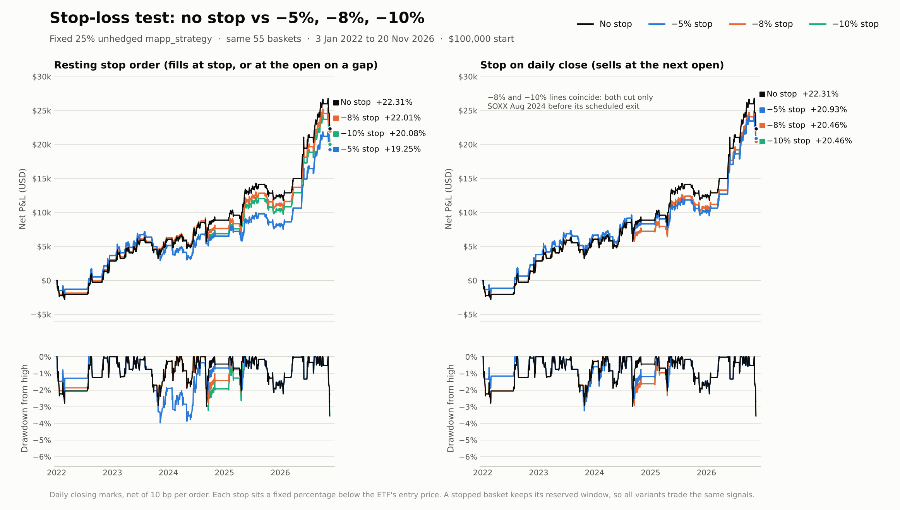
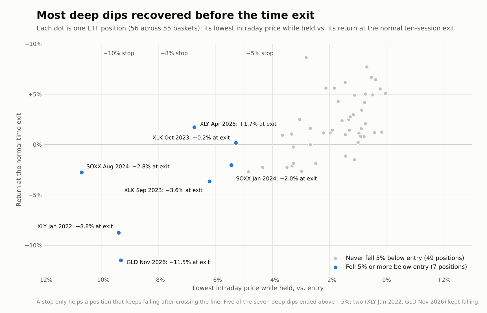

# mapp_strategy stop-loss test: −5%, −8% and −10%

**No fixed stop-loss improved the strategy.** Without a stop, the fixed 25% unhedged strategy grew $100,000 to **$122,305 (+22.31%)** from January 3, 2022 through November 20, 2026, with a **−3.55%** maximum drawdown. The best stop, a −8% resting stop order, finished at **+22.01%** with a **−2.93%** maximum drawdown. That small drawdown gain comes from a single trade, the latest GLD basket. Every other stop variant gave up 1.4 to 3.1 percentage points of return.

The test reuses the 55 baskets and the 1,227 market sessions of the [fixed 25% full-coverage backtest](../2022_2026_no_gaps_fixed25/README.md). The stop is the only change.

| Stop | Execution | Net return | CAGR | Max drawdown | Sharpe | Baskets cut by the stop | Stopped baskets vs. holding them |
|---|---|---:|---:|---:|---:|---:|---:|
| **None** | – | **+22.31%** | **+4.21%** | **−3.55%** | **1.17** | – | – |
| −5% | Resting stop order | +19.25% | +3.67% | −3.97% | 1.09 | 7 | −$2,407 |
| −8% | Resting stop order | +22.01% | +4.16% | −2.93% | 1.19 | 3 | −$111 |
| −10% | Resting stop order | +20.08% | +3.82% | −3.55% | 1.08 | 1 | −$1,963 |
| −5% | Stop on daily close | +20.93% | +3.97% | −3.24% | 1.15 | 5 | −$1,137 |
| −8% | Stop on daily close | +20.46% | +3.89% | −3.55% | 1.10 | 3* | −$1,567 |
| −10% | Stop on daily close | +20.46% | +3.89% | −3.55% | 1.10 | 1 | −$1,623 |

\* Two of these three close-based triggers fired on the last close before the scheduled exit, so they sold at the same opening as the time exit. Only SOXX (August 2024) left early.

The last column adds up, for the baskets each stop cut, the net P&L with the stop minus the net P&L of holding them to the normal exit. The difference in total return also includes compounding, because later baskets are sized from the smaller account.

## What to do with this

1. **Keep the no-stop strategy as the reference.** The ten-session time exit already limits how long a losing basket can run. A fixed stop mostly sold dips that recovered before that exit.
2. **If you want crash insurance, only the −8% resting stop order is close to free.** It cost 0.30 points of return over almost five years and capped the worst basket at −8.00% instead of −11.49%. Treat it as insurance, not as a source of return. Without the November 2026 GLD basket, it would have trailed no stop by about $1,240.
3. **Avoid the −5% stop and stops on the close.** The −5% resting stop cut seven baskets and gave up 3.06 points; two of those baskets would have finished positive. Stops on the daily close gave up 1.4 to 1.9 points. At −8% and −10% they changed only one basket, selling SOXX in September 2024 a week before it recovered.
4. **Read the evidence as thin.** Each variant changes only 1 to 7 of 55 baskets. A few thousand dollars of difference is one or two trades.

## P&L and drawdown

The curves track each other until the first stop fires, then stay offset. On the left, the −5% line falls behind from late 2023 onward after cutting two XLK baskets and one SOXX basket that all ended above the stop. On the right, the −8% and −10% close-based lines coincide. Daily closing equity for every variant is in [daily_nav.csv](daily_nav.csv).

## How the strategy trades

These rules are unchanged from the [strategy README](../../README.md#strategy-rules) and the [fixed 25% report](../2022_2026_no_gaps_fixed25/README.md#trading-rules).

1. **Signal.** Each daily *What Retail Is Playing* report lists retail themes. Only the fourth topic is used. A report counts as available at 23:59:59 New York time on its printed date.
2. **Mapping.** The topic heading is mapped into a fixed 17-ETF universe: SPY, QQQ, XLK, XLC, XLF, XLE, XLI, XLY, XLP, XLV, XLB, XLRE, XLU, SOXX, EPOL, GLD and IEF. Stocks go through a 153-stock crosswalk; for example NVDA → SOXX, TSLA → XLY, XOM → XLE and JPM → XLF. Several names in one sector count as one ETF. [Crosswalk](../../sector_mapping.csv) · [Frozen mapper](../../source_tools/frozen_mapping/map_retail_etf.py)
3. **Eligibility.** The ETF must be a USD, U.S.-session instrument with an opening price, and its median dollar volume over the prior 20 sessions must be at least $10 million.
4. **Waiting period.** At each opening, the strategy takes the newest ready report, if it is at most four calendar days old and has not been used. That report reserves the next trading window *before* the trend check. If the trend check then rejects every leg, the window still stays reserved and the money stays in cash. Only one basket is open at a time. In this replay, 93 windows were reserved and 55 were funded.
5. **Trend gate (SMA20).** A long leg needs the last completed adjusted close strictly above the average of the last 20 completed closes. A short needs it strictly below. Every funded leg in this replay was long.
6. **Sizing.** The basket gets 25% of opening equity, including the entry fee, split equally across the mapped legs. A rejected leg leaves its share in cash. Share counts stay fixed while the basket is open.
7. **Exit.** The basket is sold at the opening of the tenth following U.S. session, and never later than 21 calendar days after entry.
8. **Cooldown.** After the exit session, the strategy skips one more session before a new window can be reserved.
9. **Costs.** Every order pays 10 basis points of its notional. Cash earns nothing. Short borrow would cost 3% a year, but no short was held. There is no SPY hedge.

## How the stop-loss is added

The stop is the only new rule.

- **Level.** Each ETF position gets a fixed stop at 5%, 8% or 10% below its entry price, which is that day's adjusted opening. The stop does not trail.
- **Resting stop order.** On every held session, including the entry day, the stop is checked against the session's adjusted low. If the opening is already at or below the stop, the position is sold at that opening. Otherwise, if the low touches the stop, it is sold exactly at the stop price. On the scheduled exit day, the normal time exit at the opening comes first.
- **Stop on daily close.** If a completed adjusted close is at or below the stop, the position is sold at the next session's adjusted opening. If that opening is the scheduled exit, the result equals the time exit.
- **After a stop.** The money stays in cash until the basket's original scheduled exit, and the cooldown counts from that date. Every variant therefore trades the same 55 baskets on the same dates. This mirrors the existing rule that a reserved window stays reserved even when it is not funded, and it isolates the stop from changes in later signals.
- **Costs and prices.** A stop sale pays the same 10 bp fee as any order, with no additional slippage. Adjusted lows use the same scaling as the strategy's adjusted openings: the raw low multiplied by the ratio of the adjusted close to the raw close, from the same Yahoo price download.

## Risk and return

The definitions match the [fixed 25% report](../2022_2026_no_gaps_fixed25/README.md#full-window-risk-and-return): daily returns use the previous closing equity; volatility is the sample daily standard deviation × √252; Sharpe uses a zero risk-free rate; Sortino uses the root mean square of negative daily returns; Calmar is CAGR divided by the maximum drawdown; VaR is the empirical daily loss quantile and expected shortfall averages losses at or beyond it. "Stop" columns are resting stop orders and "close" columns are stops on the daily close.

| Metric | No stop | −5% stop | −8% stop | −10% stop | −5% close | −8% close | −10% close |
|---|---:|---:|---:|---:|---:|---:|---:|
| Ending equity | $122,305 | $119,251 | $122,009 | $120,077 | $120,934 | $120,463 | $120,463 |
| Net return | +22.31% | +19.25% | +22.01% | +20.08% | +20.93% | +20.46% | +20.46% |
| CAGR | +4.21% | +3.67% | +4.16% | +3.82% | +3.97% | +3.89% | +3.89% |
| Annualized volatility | 3.58% | 3.38% | 3.50% | 3.54% | 3.44% | 3.54% | 3.54% |
| Downside deviation | 2.35% | 2.19% | 2.28% | 2.34% | 2.25% | 2.35% | 2.35% |
| Sharpe | 1.17 | 1.09 | 1.19 | 1.08 | 1.15 | 1.10 | 1.10 |
| Sortino | 1.79 | 1.68 | 1.82 | 1.63 | 1.76 | 1.66 | 1.66 |
| Calmar | 1.19 | 0.93 | 1.42 | 1.08 | 1.22 | 1.10 | 1.10 |
| Maximum drawdown | −3.55% | −3.97% | −2.93% | −3.55% | −3.24% | −3.55% | −3.55% |
| Drawdown low point | 2026-11-20 | 2023-11-09 | 2023-10-26 | 2026-11-20 | 2023-10-26 | 2026-11-20 | 2026-11-20 |
| Daily 95% VaR / shortfall | 0.35% / 0.53% | 0.33% / 0.50% | 0.34% / 0.52% | 0.35% / 0.53% | 0.33% / 0.51% | 0.35% / 0.53% | 0.35% / 0.53% |
| Daily 99% VaR / shortfall | 0.64% / 0.85% | 0.61% / 0.79% | 0.63% / 0.82% | 0.64% / 0.85% | 0.63% / 0.82% | 0.64% / 0.85% | 0.64% / 0.85% |
| Worst day (Sep 3, 2024) | −1.93% | −1.71% | −1.93% | −1.93% | −1.93% | −1.93% | −1.93% |
| Worst basket (GLD, Nov 2026) | −11.49% | −6.26% | −8.00% | −11.49% | −8.00% | −11.49% | −11.49% |
| Worst basket, net dollars | −$3,675 | −$1,954 | −$2,549 | −$3,608 | −$2,526 | −$3,620 | −$3,620 |
| Winners / losers | 38 / 17 | 37 / 18 | 38 / 17 | 38 / 17 | 37 / 18 | 38 / 17 | 38 / 17 |
| Win rate | 69.1% | 67.3% | 69.1% | 69.1% | 67.3% | 69.1% | 69.1% |
| Profit factor | 2.60 | 2.22 | 2.57 | 2.27 | 2.43 | 2.32 | 2.32 |
| Average winner / loser | +$954 / −$821 | +$948 / −$880 | +$949 / −$826 | +$944 / −$929 | +$962 / −$814 | +$946 / −$911 | +$946 / −$911 |
| Longest losing streak | 4 | 4 | 4 | 4 | 4 | 4 | 4 |
| Order fees | $3,021 | $2,963 | $3,006 | $2,991 | $3,005 | $2,996 | $2,996 |
| Median days to a new high | 13.5 | 16.5 | 12.5 | 12.5 | 15.5 | 12.5 | 12.5 |
| Longest completed recovery | 242 days | 396 days | 244 days | 245 days | 242 days | 244 days | 244 days |
| Sessions below the running high | 1,075 | 1,125 | 1,083 | 1,084 | 1,091 | 1,083 | 1,083 |

The −8% resting stop has the best Sharpe, Sortino and Calmar, but by small margins, and only because of the GLD basket. The −5% stop lowers volatility and the worst day, but its longest recovery stretches to 396 days. Machine-readable values for every variant, with input fingerprints and the two reproduction checks, are in [risk_metrics.json](risk_metrics.json) and [metrics.csv](metrics.csv).

### Calendar years

Each year uses the prior year-end equity as its base. Within-year maximum drawdowns are in parentheses. [CSV](calendar_year_returns.csv)

| Year | No stop | −5% stop | −8% stop | −10% stop | −5% close | −8% close | −10% close |
|---|---:|---:|---:|---:|---:|---:|---:|
| 2022 | +2.86% (−2.79%) | +3.66% (−2.03%) | +3.06% (−2.60%) | +2.86% (−2.79%) | +3.80% (−1.90%) | +2.86% (−2.79%) | +2.86% (−2.79%) |
| 2023 | +3.11% (−2.93%) | +1.43% (−3.97%) | +3.11% (−2.93%) | +3.11% (−2.93%) | +2.77% (−3.24%) | +3.11% (−2.93%) | +3.11% (−2.93%) |
| 2024 | +2.65% (−2.98%) | +1.31% (−2.06%) | +1.30% (−2.74%) | +0.78% (−3.24%) | +1.54% (−2.50%) | +1.10% (−2.98%) | +1.10% (−2.98%) |
| 2025 | +3.01% (−2.15%) | +1.29% (−2.15%) | +3.01% (−2.15%) | +3.01% (−2.15%) | +1.45% (−2.15%) | +3.01% (−2.15%) | +3.01% (−2.15%) |
| 2026 to Nov 20 | +9.07% (−3.55%) | +10.53% (−2.25%) | +10.04% (−2.69%) | +9.07% (−3.55%) | +10.04% (−2.69%) | +9.07% (−3.55%) | +9.07% (−3.55%) |

Where a stop changed the result, it helped in 2022 (XLY) and 2026 (GLD) and hurt in 2023, 2024 and 2025. No level beat no stop in every year.

## Why the stops did not help

A stop pays off only when a position keeps falling after it crosses the stop. In this replay that was rare:

- **Only 7 of 56 positions ever traded 5% or more below entry.** Three reached −8% and one reached −10%. The other 49 never came near any stop.
- **Five of those seven recovered above −5% by the normal exit, and two finished positive:** XLY (April 2025) at +1.71% and XLK (October 2023) at +0.18%.
- **SOXX (August 2024) is the most expensive case.** Semiconductors sold off in the first week of September 2024; the position touched −10.67% and then recovered to −2.75% by the September 13 exit. Every one of the six stop variants sold it, at −5% to −10%, before the recovery.
- **Only two positions kept falling:** XLY (January 2022, −8.75% at exit) and GLD (November 2026, −11.49% at exit). GLD gapped through the −5% stop at the opening and filled at −6.26%; the next day it opened just past the −8% stop.

Each position's worst intraday and worst closing price while held are in [position_excursions.csv](position_excursions.csv).

### Every basket a stop cut

Returns are the basket's price return; dollar amounts are net of fees. "Effect" is the stopped basket's net P&L minus the same basket held to its normal exit. [CSV](stopped_trades.csv) · [All baskets for all variants](trades.csv)

| Stop | ETF | Entry | Stop exit | Normal exit | How it filled | With stop | If held | Effect |
|---|---|---|---|---|---|---:|---:|---:|
| −5% stop | XLY | 2022-01-05 | 2022-01-10 | 2022-01-20 | Gap at the opening | −5.70% | −8.75% | +$763 |
| −5% stop | XLK | 2023-09-15 | 2023-09-26 | 2023-09-29 | At the stop | −5.00% | −3.65% | −$367 |
| −5% stop | XLK | 2023-10-19 | 2023-10-26 | 2023-11-02 | At the stop | −5.00% | +0.18% | −$1,356 |
| −5% stop | SOXX | 2024-01-24 | 2024-01-31 | 2024-02-07 | At the stop | −5.00% | −2.02% | −$777 |
| −5% stop | SOXX | 2024-08-29 | 2024-09-03 | 2024-09-13 | At the stop | −5.00% | −2.75% | −$586 |
| −5% stop | XLY | 2025-04-10 | 2025-04-21 | 2025-04-25 | At the stop | −5.00% | +1.71% | −$1,805 |
| −5% stop | GLD | 2026-11-06 | 2026-11-18 | 2026-11-20 | Gap at the opening | −6.26% | −11.49% | +$1,722 |
| −8% stop | XLY | 2022-01-05 | 2022-01-19 | 2022-01-20 | At the stop | −8.00% | −8.75% | +$188 |
| −8% stop | SOXX | 2024-08-29 | 2024-09-06 | 2024-09-13 | At the stop | −8.00% | −2.75% | −$1,425 |
| −8% stop | GLD | 2026-11-06 | 2026-11-19 | 2026-11-20 | Gap at the opening | −8.00% | −11.49% | +$1,127 |
| −10% stop | SOXX | 2024-08-29 | 2024-09-06 | 2024-09-13 | At the stop | −10.00% | −2.75% | −$1,963 |
| −5% close | XLY | 2022-01-05 | 2022-01-11 | 2022-01-20 | Next opening | −5.16% | −8.75% | +$895 |
| −5% close | XLK | 2023-09-15 | 2023-09-27 | 2023-09-29 | Next opening | −4.95% | −3.65% | −$355 |
| −5% close | SOXX | 2024-08-29 | 2024-09-04 | 2024-09-13 | Next opening | −7.04% | −2.75% | −$1,173 |
| −5% close | XLY | 2025-04-10 | 2025-04-22 | 2025-04-25 | Next opening | −4.35% | +1.71% | −$1,653 |
| −5% close | GLD | 2026-11-06 | 2026-11-19 | 2026-11-20 | Next opening | −8.00% | −11.49% | +$1,149 |
| −8% close | XLY | 2022-01-05 | 2022-01-20 | 2022-01-20 | Next opening = normal exit | −8.75% | −8.75% | $0 |
| −8% close | SOXX | 2024-08-29 | 2024-09-09 | 2024-09-13 | Next opening | −8.75% | −2.75% | −$1,623 |
| −8% close | GLD | 2026-11-06 | 2026-11-20 | 2026-11-20 | Next opening = normal exit | −11.49% | −11.49% | +$55 |
| −10% close | SOXX | 2024-08-29 | 2024-09-09 | 2024-09-13 | Next opening | −8.75% | −2.75% | −$1,623 |

The +$55 for the −8% close GLD row is not a price difference. An earlier SOXX stop left the account smaller, so the GLD position was smaller.

## Limits of this test

- **Small sample.** Each variant changes 1 to 7 of 55 baskets. These results describe a handful of episodes, not a stable property of stops.
- **The −8% result rests on the last trade.** The November 2026 GLD basket closed on the final session of the replay. Without it, the −8% resting stop would trail no stop.
- **Optimistic fills.** Resting stops fill exactly at the stop price unless the opening gaps through it. Real stop orders usually fill a little worse, which would make every stop variant slightly weaker.
- **Daily bars only.** The test knows each session's opening, low and close, but not the order of prices within the day after the opening.
- **No re-entry after a stop.** A rule that frees the waiting period after a stop would trade a different schedule. That was not tested.
- **Unhedged book only.** The SPY-hedged policies were not tested with stops.
- **Same source assumptions as the main study.** Reports are current retrospective reconstructions, and their availability at the printed date is a simulation assumption.
- **Levels were given, not optimized.** The three levels were requested in advance; no other level was tried.

## Reproduction and checks

From `strategies/mapp_strategy`, in a fresh copy without earlier results, first run the extended-history study. It downloads the reports and Yahoo prices and simulates the frozen strategy:

~~~bash
python -m pip install -r requirements.txt
python mapp_strategy.py extended-history --start 2022-01-01 --end 2026-11-20 --workers 12
~~~

Then run the stop-loss test against that completed run directory. Pass the run directory's path as `--root`; outputs go to this folder by default:

~~~bash
python mapp_strategy.py stoploss-sensitivity --root .
~~~

The script refuses to write results unless two checks pass:

- **Engine identity.** With stops disabled, its simulator must reproduce the frozen engine's `unhedged25` daily equity. In this run the largest difference was 0.
- **Published statistics.** Its no-stop risk statistics must match the published [fixed 25% metrics](../2022_2026_no_gaps_fixed25/risk_metrics.json), including returns, volatility, Sharpe, Sortino, Calmar, drawdown, VaR, shortfall, fees and recovery days. They matched.

This run used a fresh download made on November 21, 2026. It reproduced the published fixed-25% ledger: all 55 baskets had the same dates, and daily equity differed by at most $0.03. The input fingerprints are in [risk_metrics.json](risk_metrics.json). Raw reports and raw price files stay on the machine that ran the study, as in the other mapp_strategy backtests.

## Files

| File | Contents |
|---|---|
| [README.md](README.md) | This report |
| [figures/stoploss_pnl_drawdown.png](figures/stoploss_pnl_drawdown.png) | Net P&L and drawdown for all seven variants |
| [figures/position_excursions.png](figures/position_excursions.png) | Worst intraday dip against the return at the normal exit, per position |
| [risk_metrics.json](risk_metrics.json) | Every risk statistic per variant, reproduction checks and input fingerprints |
| [metrics.csv](metrics.csv) | Flat table of the headline statistics |
| [calendar_year_returns.csv](calendar_year_returns.csv) | Yearly returns and within-year drawdowns |
| [daily_nav.csv](daily_nav.csv) | Daily closing equity for every variant |
| [trades.csv](trades.csv) | Every basket for every variant, with prices, stop levels, fees and P&L |
| [stopped_trades.csv](stopped_trades.csv) | The baskets each stop cut, compared with holding them |
| [position_excursions.csv](position_excursions.csv) | Each position's worst intraday and closing price while held, and its return at the normal exit |
| [../../ci/stoploss_sensitivity.py](../../ci/stoploss_sensitivity.py) | The script that produced this folder |
