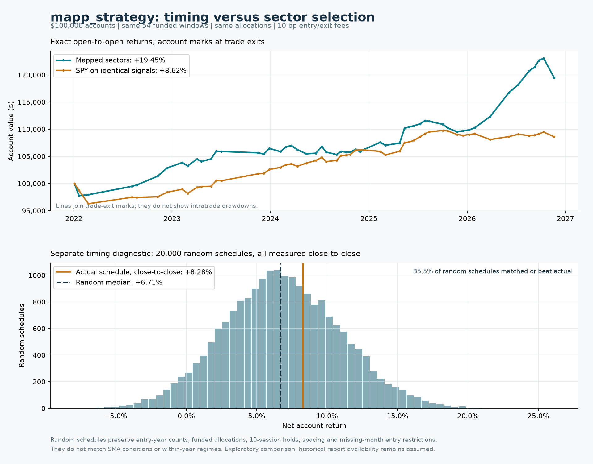

# Timing versus sector selection

This comparison reads the immutable saved mapp_strategy simulation for January 2022–November 20, 2026. It changes no strategy rules and downloads no new reports or prices.

## Same signals: mapped instrument or SPY

SPY replaces each funded mapped basket in a separate account. Both use the same entry/exit opens and funded fraction of their own NAV, compound independently from $100,000, pay 10 bp at entry and exit, and earn zero cash interest. The XLC basket 40 retains its half allocation. The original sector qualification determines the schedule; SPY receives no additional SMA filter.

| Entry cohort | Baskets | Mapped instruments, net | SPY on identical signals, net |
|---|---:|---:|---:|
| All entries | 54 | +19.45% | +8.62% |
| Entries in 2022–2025 | 45 | +9.87% | +9.01% |
| Entries in 2026 | 9 | +8.72% | -0.36% |

These are entry cohorts, not calendar returns. Basket 71 entered December 23, 2025 and exited January 8, 2026.



The chart joins account marks at trade exits; it does not show intratrade drawdowns.

## Gross attribution on the original source notionals

| Component | USD |
|---|---:|
| SPY returns during the selected windows | +11,911.35 |
| Mapped instrument return above SPY | +10,446.35 |
| Original source gross PnL | +22,357.70 |
| Original source fees | −2,904.26 |
| Original source net PnL | +19,453.44 |

The first row is market contribution during selected dates, not proof of timing alpha. The additive attribution uses original source notionals; it is distinct from the independently compounded benchmark accounts.

Selection is concentrated: **95.63%** of aggregate gross sector excess comes from 2026 entries and **88.44%** from six XLE baskets. The instrument beat SPY in 30 of 54 windows, with one genuine-SPY tie. Before 2026 the gross selection contribution was only $456.17.

| Entry year | Baskets | Mapped instruments, net | Matched SPY, net |
|---|---:|---:|---:|
| 2022 | 6 | +2.86% | -1.62% |
| 2023 | 10 | +3.51% | +4.27% |
| 2024 | 15 | -0.13% | +3.50% |
| 2025 | 14 | +3.33% | +2.67% |
| 2026 | 9 | +8.72% | -0.36% |

## Random-timing diagnostic

This separate diagnostic uses **close-to-close returns for both actual and random schedules**, because saved opening prices are unavailable for randomly selected dates. Do not compare the exact open-to-open +8.62% result directly with this distribution.

20,000 random schedules preserve annual entry counts (6/10/15/14/9), ten-SPY-session holds, at least twelve sessions between entries, the same chronological funded-fraction sequence, no entries in absent-report months, the endpoint, 10 bp entry/exit fees and zero cash yield. Normal exits in missing months remain allowed.

Within each year, dynamic-programming counts sample uniformly from admissible nonoverlapping schedules. Entire combined schedules with cross-year conflicts are rejected. Mulberry32 seed 20261121 produced 230,607 attempts, including 210,607 cross-year rejections.

| Close-to-close comparison | Net return |
|---|---:|
| Actual signal dates | +8.28% |
| Random schedule median | +6.71% |
| Random schedule mean | +6.81% |
| Random 5th–95th percentile | +0.05% to +13.74% |

**35.535%** of random schedules matched or beat the actual result. The actual schedule sits at approximately the 64th percentile, providing no compelling evidence of superior timing under this control.

This is an exploratory timing-package diagnostic, not a significance level adjusted for prior strategy research. Random schedules match year counts and gaps, not all SMA conditions, volatility or within-year regimes. Sector excess includes sector momentum filtering and factor-risk differences; it does not isolate report-specific information. Historical report availability remains assumed.

## Reproduce and verify

From `strategies/mapp_strategy`:

```bash
python -m pip install -r requirements.txt
python ci/analyze_timing_selection.py --archive backtests/2022_2026_month_gaps/mapp_strategy_extended_simulated_results.zip --out timing_selection_outputs
```

Use a new output directory. The archive is pinned by SHA256 `fb38b0cc881183a9e6cba642b31beac6b640aac0f937aa90ae9235fc758a5d59`. The script uses saved simulated ledgers only.

[Successful execution](https://github.com/marcinzieba4-bot/DailyDigest_Markets/actions/runs/44836621006) · [54 matched windows](matched_windows.csv) · [Summary](summary.json) · [Independent checks](independent_checks.json) · [Code](../../ci/analyze_timing_selection.py)

The Python reproduction matched an independent JavaScript reconstruction of all 54 windows and all 20,000 timing controls. CSV and PNG payload hashes were checked, and the chart was visually inspected. Original strategy simulation code and sector mapping are unchanged.
